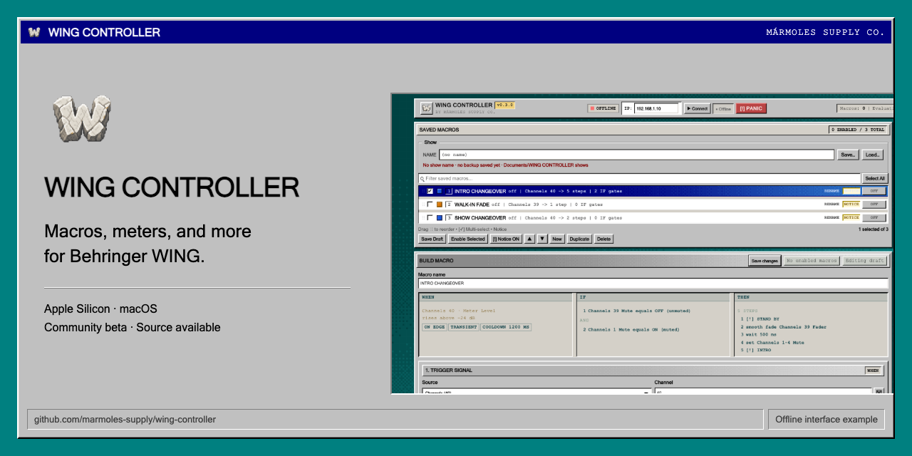
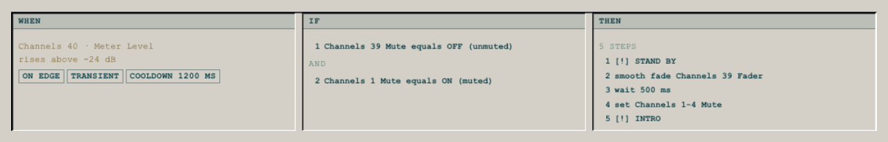
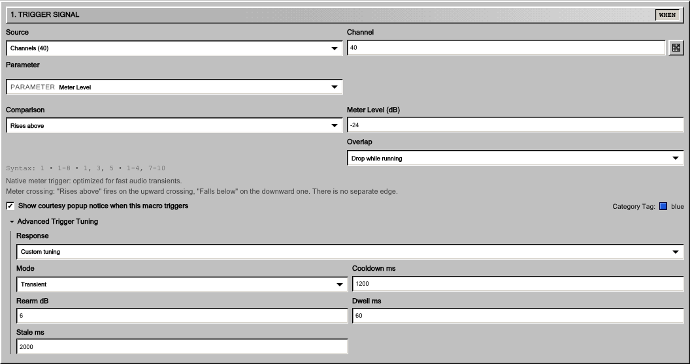
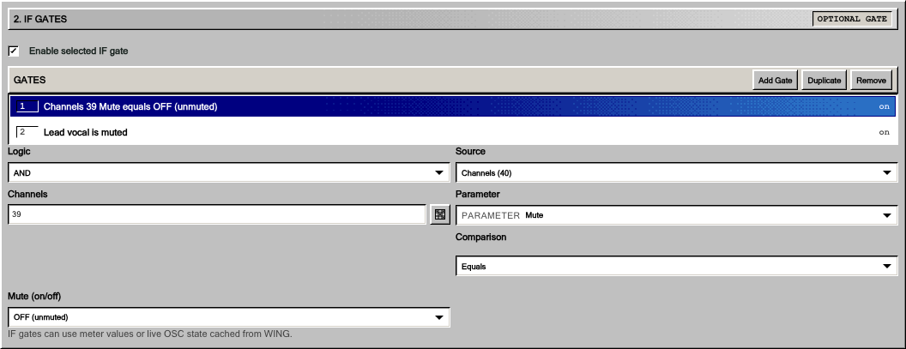
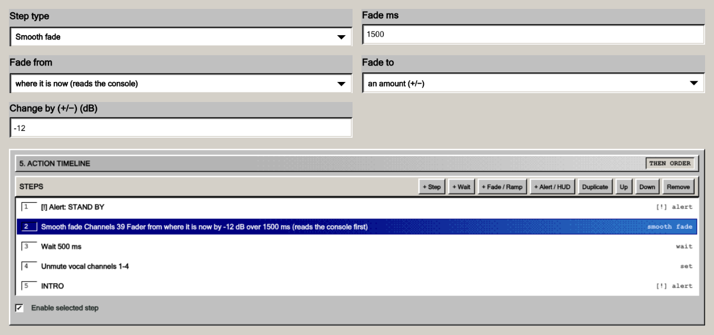
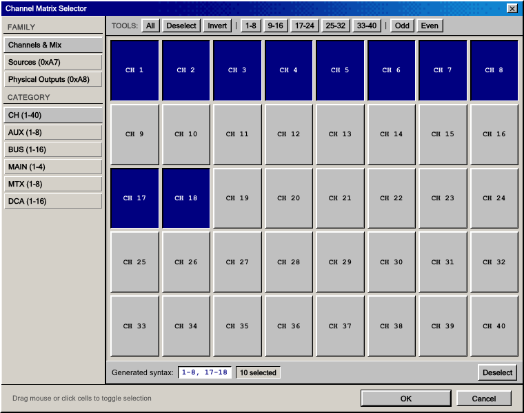
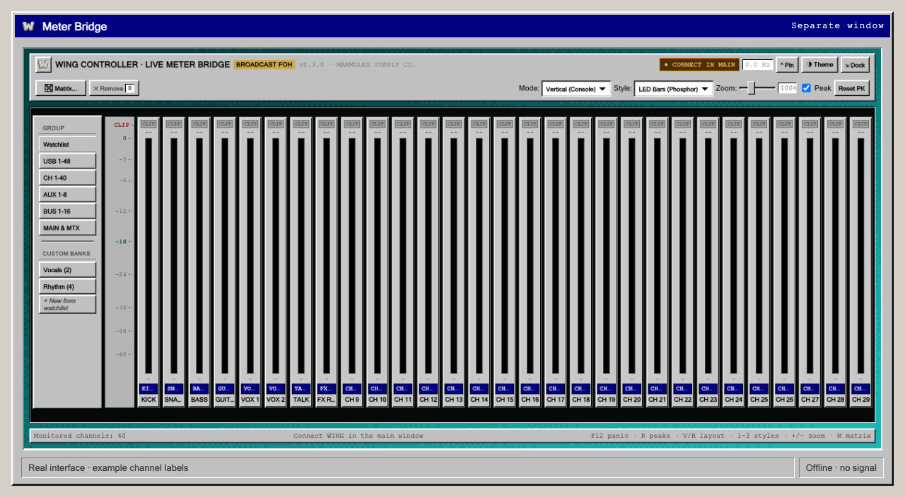
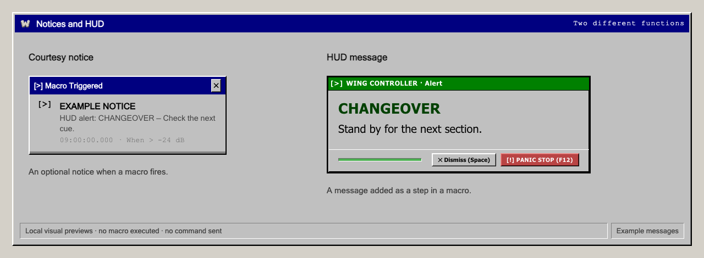
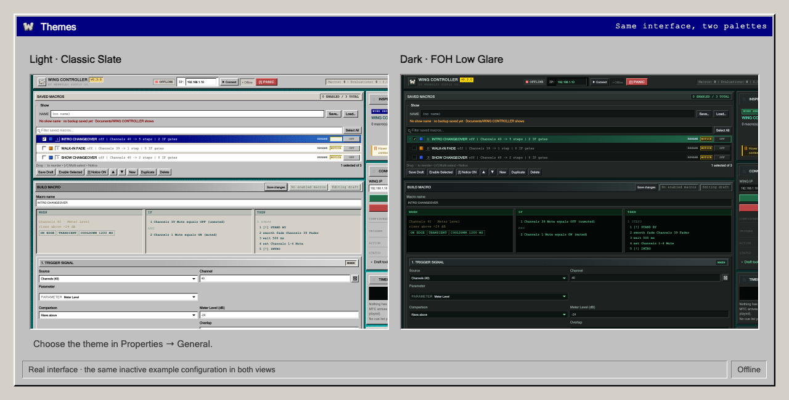
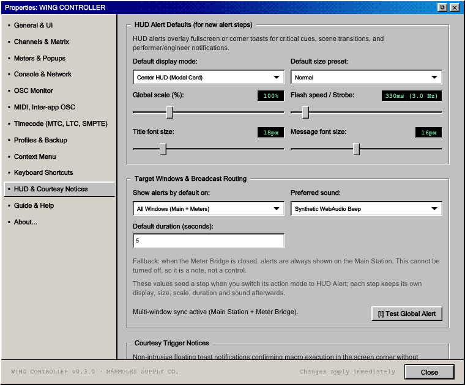

# WING CONTROLLER

**[Página del proyecto](https://marmoles-supply.github.io/wing-controller/?lang=es)** · [English](https://marmoles-supply.github.io/wing-controller/)

**Macros, medidores y otras herramientas para Behringer WING.** Proyecto
independiente para la comunidad, con una interfaz de escritorio clásica y código
disponible para estudiar, modificar y mejorar entre todos.

Crea macros a partir de niveles de audio, estados de la consola o mensajes
MIDI/OSC entre aplicaciones o cues de timecode LTC/MTC. Añade condiciones y
acciones con tiempos, abre los medidores en otra ventana y muestra mensajes al operador. Sigue mezclando con la consola o con tu
aplicación de control habitual.

**[Descargar para Mac Apple Silicon — v0.3.0 beta](https://github.com/marmoles-supply/wing-controller/releases/download/v0.3.0/WING_CONTROLLER_v0.3.0_AppleSilicon.dmg)**

[Instalación paso a paso](docs/INSTALLATION.es.md) · [Release y checksums](https://github.com/marmoles-supply/wing-controller/releases/tag/v0.3.0) · [Guía de uso, en inglés](docs/guide/README.md) · [Feedback](https://github.com/marmoles-supply/wing-controller/issues/new/choose) · [English](README.md)

**Solo para Mac Apple Silicon / serie M.** Está firmada con un certificado propio, **sin notarización de Apple**. La guía explica cómo autorizar la primera
apertura. No hay instalador compatible con Intel, Windows o Linux; tampoco se ha
establecido un rango amplio de versiones de macOS.

**Beta para la comunidad.** Muchas funciones con hardware e integraciones todavía
necesitan pruebas reales. Lee el [disclaimer](DISCLAIMER.md#community-beta-and-incomplete-validation)
y participa en las [pruebas de la comunidad](docs/COMMUNITY_TESTING.md).

> **Software no oficial. Cada cual lo utiliza bajo su responsabilidad.** No es un
> producto de Behringer ni de Music Tribe y no cuenta con su aprobación,
> certificación, soporte ni respaldo. Se distribuye sin garantías. Debes probar tu
> equipo, guardar copias independientes y mantener una forma de operar y recuperar
> el sistema manualmente. Lee el [disclaimer completo, en inglés](DISCLAIMER.md)
> antes de usarlo, especialmente en un show.

## Instalación

1. Descarga el **DMG de Apple Silicon** desde Releases y comprueba su checksum.
2. Abre el DMG y **arrastra WING CONTROLLER.app a Aplicaciones**.
3. **Expulsa el DMG** y abre la copia instalada. Si macOS la bloquea, sigue la
   [guía de primera apertura](docs/INSTALLATION.es.md#primera-apertura).

No necesitas herramientas de desarrollo. Los enlaces **Source code** de GitHub
son el código del proyecto, no la aplicación instalable.

## Macros

Cada macro combina un **WHEN** (cuándo), condiciones **IF** opcionales y una
secuencia **THEN**. Este ejemplo incluye un disparador por nivel, dos condiciones
de estado, un mensaje HUD, un smooth fade relativo, una espera, una acción sobre
varios canales y otro HUD.

| Parte | Qué permite configurar |
| --- | --- |
| WHEN | Umbrales de medidores y comparaciones de estado de la consola. Las asignaciones MIDI/OSC y los cues de timecode ofrecen otras formas de disparo. |
| IF | Hasta 16 condiciones con AND u OR, a partir de valores de medidor o consola. Se evalúan al llegar el disparador por medidor o estado de la consola. |
| THEN | Hasta 32 pasos ordenados: Set, Toggle, Wait, Wait then Set, Fade, Smooth Fade, HUD, Send MIDI o Send OSC. Los modos disponibles dependen del destino. |
| Fade | Partir de un valor elegido o del valor actual de la consola; ir a un valor o moverlo una cantidad relativa, con las unidades y límites del parámetro. |
| Repetición | Ignorar otro disparo, guardar una ejecución pendiente o reiniciar la secuencia. |

Ver los ajustes del disparador, las condiciones y el editor de acciones

### Ajustes del disparador

Hay presets y ajustes de respuesta. Rearm y dwell se aplican al transitorio
ascendente; las otras rutas utilizan sus reglas de cruce y cooldown.

### Condiciones IF

Es una lista unida por AND u OR, no ramas anidadas. Se comprueba al llegar el
disparador por medidor o estado de la consola; no supervisa continuamente las
acciones posteriores.

### Valores y secuencia de acciones

El fade seleccionado lee el fader actual de la música y lo reduce 12 dB en
1.500 ms. Después hay una espera independiente y más acciones. Los canales y
valores son ilustrativos: es un ejemplo inactivo de la interfaz, no un preset de
show probado.

[Disparadores](docs/guide/02-triggers.md) · [Acciones y tiempos](docs/guide/03-actions-and-timing.md) · [Macros y límites](docs/guide/04-macros-and-limits.md), en inglés.

## Selección de canales

Selecciona canales y grupos compatibles en una cuadrícula, con herramientas por
bancos y rangos. La cuadrícula del disparador elige un canal, y el campo escrito también admite
listas y rangos. Los destinos de acciones y las listas de medidores admiten varios
cuando corresponde. Es un selector de canales,
no una matriz de ruteo de audio.

## Meter Bridge

Una ventana independiente de medidores, con bancos, tamaños y estilos visuales.
Puedes dejarla junto al editor o en otra pantalla. La disponibilidad depende de
la consola y la fuente. El estilo VU analógico no implica balística VU calibrada.

## Notices y HUD

El **courtesy notice** opcional informa de qué macro se ha disparado, resume su
acción y muestra la hora. El **HUD** es una acción que añades a la macro para
mostrar un mensaje centrado, en una esquina o a pantalla completa, con sonido
opcional. Un aviso no demuestra que la consola haya confirmado la orden ni
sustituye un sistema de seguridad.

Las imágenes muestran la interfaz real con configuraciones de ejemplo, sin
consola conectada, ejecución de macros ni señal simulada.
[Origen y generación de las imágenes, en inglés](assets/product/README.md).

## Temas y ajustes

Puedes elegir **Light (Classic Slate)** o **Dark (FOH Low Glare)** en Properties →
General. Cambia la paleta; los controles y la configuración son los mismos.

Ajustes del HUD

Estos ajustes se aplican a pasos nuevos. Los existentes conservan sus valores.

## MIDI/OSC entre aplicaciones y timecode

Los mensajes MIDI y OSC entrantes pueden lanzar macros; las secuencias también
pueden enviar mensajes MIDI/OSC. [Configuración inter-app, en inglés](docs/guide/12-midi-and-other-applications.md).

Incluye herramientas de LTC (timecode de audio), MTC (timecode MIDI) y cues en
beta: analizar archivos WAV de LTC, seguir entradas de timecode y asociar
posiciones a macros. [Guía de timecode, en inglés](docs/guide/13-timecode.md).
Los recorridos con hardware y otras aplicaciones necesitan pruebas de la
comunidad; consulta las [prioridades](docs/COMMUNITY_TESTING.md#what-needs-testing).

## Colaborar

No hace falta programar para ayudar. Puedes informar de errores, proponer
mejoras, comunicar pruebas y contar qué ha funcionado y qué no.

**[Reportar un error](https://github.com/marmoles-supply/wing-controller/issues/new?template=01-bug-report.yml)** · **[Proponer una mejora](https://github.com/marmoles-supply/wing-controller/issues/new?template=02-improvement.yml)** · **[Comunicar una prueba](https://github.com/marmoles-supply/wing-controller/issues/new?template=03-test-report.yml)** · **[Compartir una experiencia](https://github.com/marmoles-supply/wing-controller/issues/new?template=04-experience.yml)**

[Cómo probar y cómo se gestionan los informes, en inglés](docs/COMMUNITY_TESTING.md).
Puedes escribir en español o inglés. Necesitas una cuenta de GitHub para enviar
un informe. El repositorio contiene:

- [To-do y prioridades](docs/ROADMAP.md), con trabajo sobre guardado y recuperación,
  LTC/MTC físico, hardware y mantenimiento.
- [Guía para contribuir](CONTRIBUTING.md): elegir una tarea, comprobar el cambio y
  enviar una pull request.
- [Issues](https://github.com/marmoles-supply/wing-controller/issues/new/choose),
  [auditoría](docs/AUDIT_2026-11-09.md) y [arquitectura](docs/ARCHITECTURE.md).
- [Instrucciones de desarrollo](README.md#development) y [guía de uso](docs/guide/README.md), en inglés.

La documentación técnica y la guía completa están en inglés. Antes de publicar
un informe, elimina datos privados de shows, clientes y consolas. Las
vulnerabilidades se comunican por el [canal privado de seguridad](SECURITY.md).

## Licencia

© 2026 **MÁRMOLES SUPPLY CO.** y colaboradores.

La [WING CONTROLLER Source-Available Licence 1.0](LICENSE) permite usar, estudiar,
modificar y compartir el programa. **Está permitido el uso profesional, incluidos
shows remunerados. Está prohibida la venta de copias o derivados.** Al
redistribuir, hay que incluir el código correspondiente bajo la misma licencia.

Por esa restricción de venta, es **código disponible: no una licencia open source
OSI ni GPL**. No se convierte en permisiva más adelante. Los componentes de
terceros conservan [sus propias licencias](THIRD_PARTY.md). Los nombres de marcas
indican compatibilidad, sin afiliación ni respaldo.
