# WING CONTROLLER

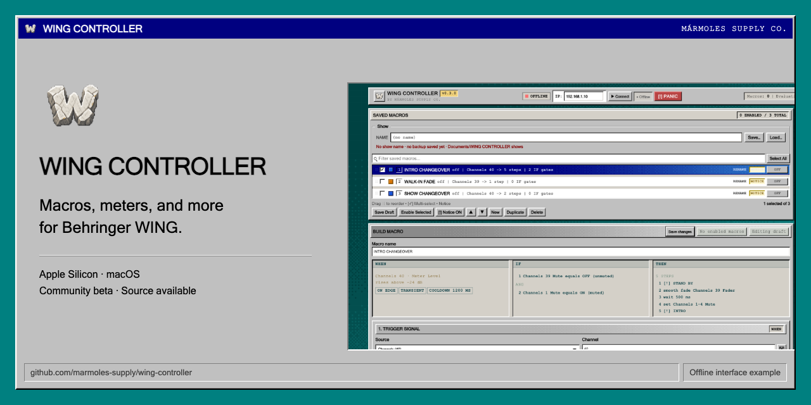

**Macros, meters, and more for Behringer WING.** An independent community project
for Apple Silicon Macs, with a classic desktop interface.

Build macros from audio thresholds, console state, inter-app MIDI/OSC or LTC/MTC
timecode cues. Add conditions and timed actions, keep meters in their own window, and display
messages for the operator. Keep mixing with your console or preferred control app.

[](https://github.com/marmoles-supply/wing-controller/releases/download/v0.3.0/WING_CONTROLLER_v0.3.0_AppleSilicon.dmg)

[Installation guide](docs/INSTALLATION.md) · [Release notes and checksums](https://github.com/marmoles-supply/wing-controller/releases/tag/v0.3.0) · [Operator guide](docs/guide/README.md) · [Feedback](https://github.com/marmoles-supply/wing-controller/issues/new/choose) · [Español](README.es.md)

**Apple Silicon / M-series Macs only.** The application is self-signed and **not notarised by Apple**; the installation guide
explains first-launch approval.

**Community beta.** Many hardware and inter-application workflows still need
real-world testing. Read the [disclaimer](DISCLAIMER.md#community-beta-and-incomplete-validation)
and help with [community testing](docs/COMMUNITY_TESTING.md).

> **Unofficial software. Use at your own risk.** This is not a Behringer or Music
> Tribe product and is not affiliated with, approved, certified, supported or
> endorsed by either company. It comes without warranties. You are responsible
> for testing your setup, keeping backups and maintaining a manual recovery plan.
> Read the [full disclaimer](DISCLAIMER.md) before using it, especially at a show.

## Install

1. **[Download the Mac DMG](https://github.com/marmoles-supply/wing-controller/releases/download/v0.3.0/WING_CONTROLLER_v0.3.0_AppleSilicon.dmg)** from this repository's Releases. Check it against `SHA256SUMS.txt` from the same release.
2. Open the DMG and **drag WING CONTROLLER.app to Applications**.
3. **Eject the DMG**, then open the copy in Applications. If macOS blocks it, follow the [first-launch instructions](docs/INSTALLATION.md#first-launch-on-macos).

No developer tools are needed. GitHub's **Source code** downloads contain the
project's source, rather than an installable app.

## Macros

A macro combines a **WHEN**, optional **IF** conditions, and an ordered **THEN**
sequence. The example below has a meter trigger, two console-state conditions,
a HUD message, a relative smooth fade, a wait, a multi-channel action and a second
HUD message.

[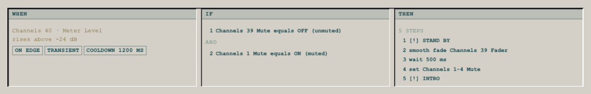](assets/product/macro-recipe-light.png)

| Part | What you can configure |
| --- | --- |
| WHEN | Meter thresholds or typed console-state comparisons. MIDI/OSC bindings and timecode cues provide additional firing routes. |
| IF | Up to 16 gates, joined with AND or OR, using supported meter or console values. These are checked when the meter or console-state trigger arrives. |
| THEN | Up to 32 ordered steps: Set, Toggle, Wait, Wait then Set, Fade, Smooth Fade, HUD, Send MIDI or Send OSC. Available modes depend on the target. |
| Fade | Start at a chosen value or the console's current value; aim at a value or a relative change, with the parameter's units and range. |
| Retrigger | Drop another trigger, queue one follow-up run, or restart the sequence. |

<details>
<summary>See the trigger tuning, IF gates and action editor</summary>

### Trigger tuning

[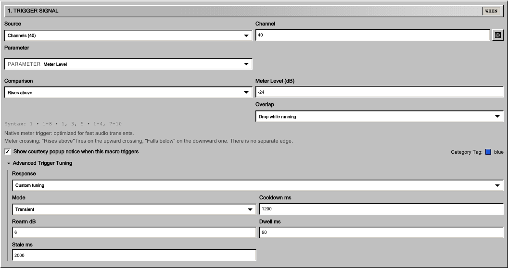](assets/product/macro-trigger-light.png)

Meter triggers provide response presets and custom tuning. Rearm and dwell apply
to rising transients; other paths use their crossing and cooldown rules.

### IF conditions

[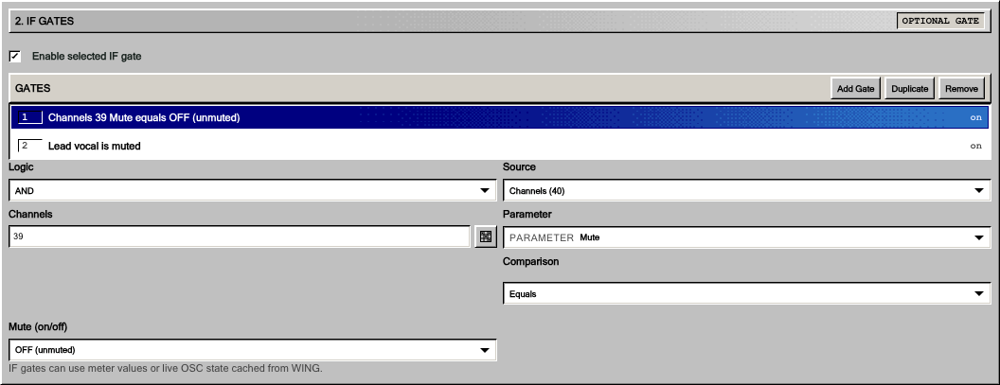](assets/product/macro-if-light.png)

The gates form one AND or OR list, rather than nested branches. They are checked
when the meter or console-state trigger arrives, rather than continuously
supervising later actions.

### Action settings and timeline

[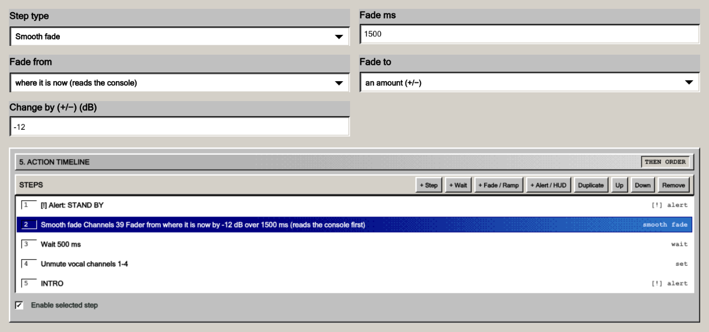](assets/product/steps-detail.png)

The selected fade reads the current playback fader, then reduces it by 12 dB over
1,500 ms. A separate wait and later actions follow sequentially. Channel roles
and values are illustrative; this is an inactive interface example, not a tested
show preset.

[Trigger guide](docs/guide/02-triggers.md) · [Actions and timing](docs/guide/03-actions-and-timing.md) · [Macros and limits](docs/guide/04-macros-and-limits.md).

</details>

### Channel selection

Choose supported channels and groups from a visual grid. Bank buttons and
selection tools help build target lists and meter views. This is a channel
selector; audio routing is a separate function.

[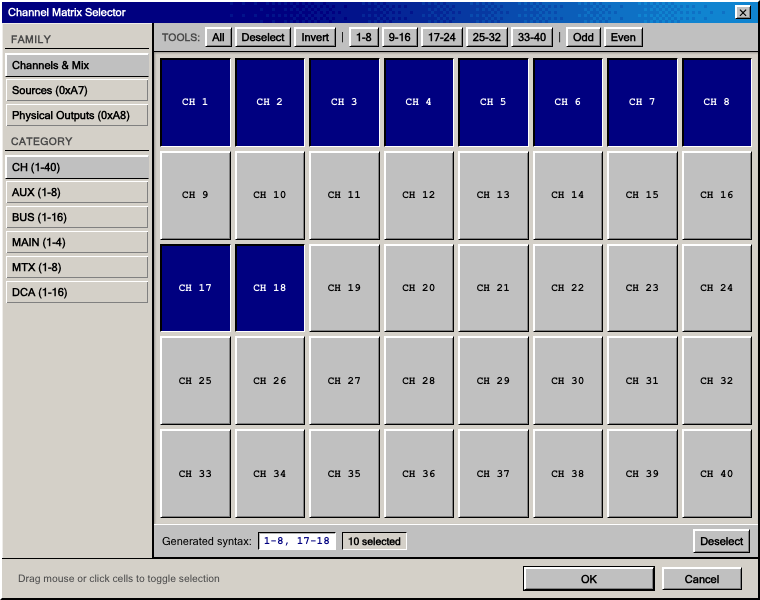](assets/product/channel-selection-light.png)

The trigger grid selects one channel; typed trigger lists/ranges are also
supported. Action targets and meter lists can select several, where supported. The meter picker can **add** to the view or **replace** it.
[Meter and bank guide](docs/guide/05-meters-and-banks.md).

## Meter Bridge

Open meters in a separate window, organise them into named banks and choose a
layout, size and visual style. Keep that window alongside the workstation or on
another display.

[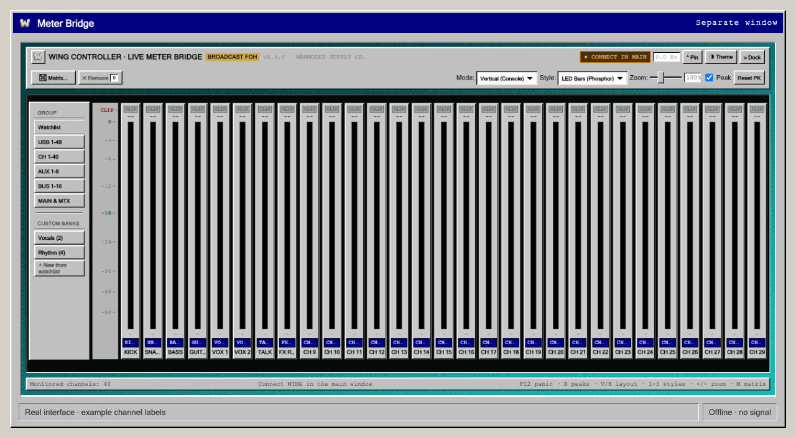](assets/product/meter-bridge-light.png)

Meter availability depends on the connected console and source. The analogue VU
option is a visual style, rather than a claim of calibrated VU ballistics.
[Meter Bridge guide](docs/guide/05-meters-and-banks.md).

## Notices and HUD messages

An optional **courtesy notice** shows which macro fired, its action summary and
the time. A **HUD message** is a separate action you can add to a macro: a centred
card, corner notice or full-screen message, with optional sound.

[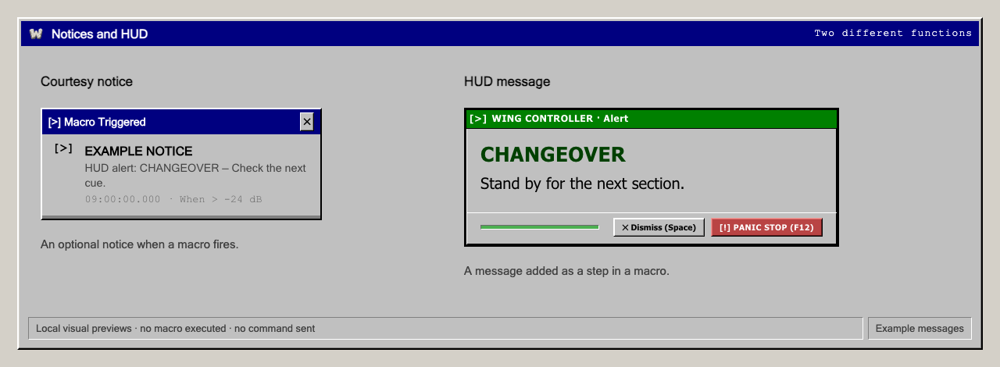](assets/product/messages-detail.png)

These messages report app activity; they do not prove a console accepted a
command or replace a safety system. [Macro notices](docs/guide/04-macros-and-limits.md)
· [HUD actions](docs/guide/03-actions-and-timing.md).

All images above use the real interface with example configurations, rendered
offline. No console is connected, no macro is executed and no meter signal is
simulated. [Media sources and regeneration](assets/product/README.md).

<details>
<summary>Full workstation, light and dark themes, and meter selection</summary>

### Classic light

[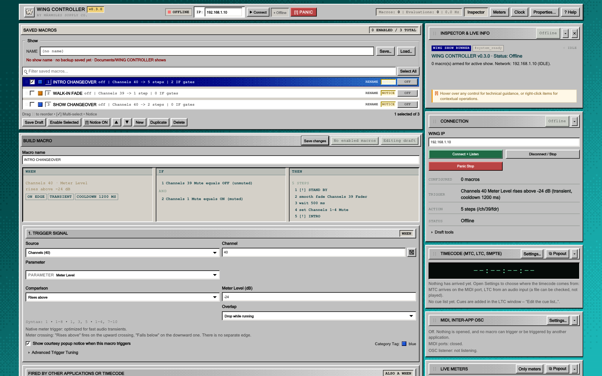](assets/product/workstation-light.png)

### Dark

[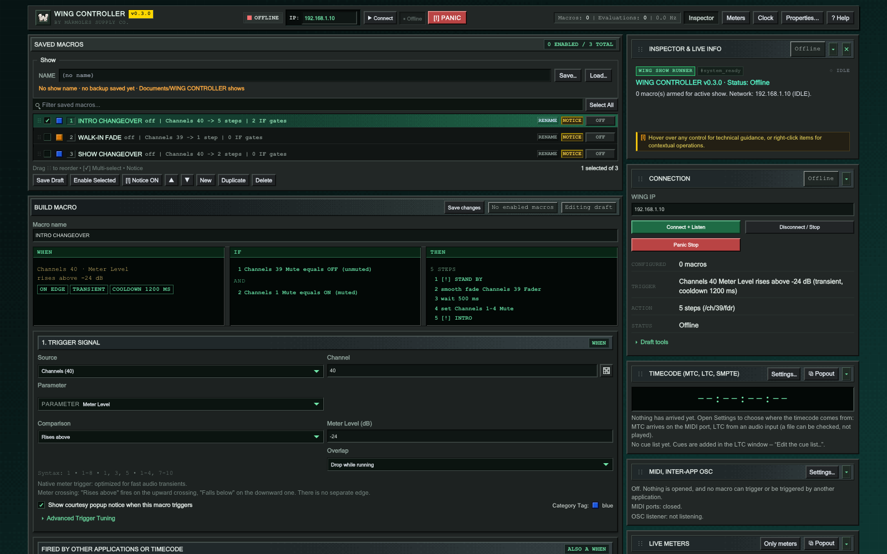](assets/product/workstation-dark.png)

### Meter selection

[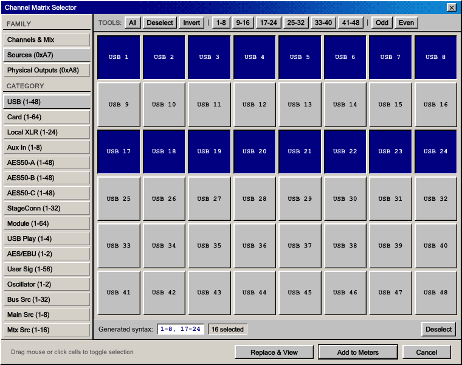](assets/product/meter-selection-light.png)

</details>

## Themes

Choose **Light (Classic Slate)** or **Dark (FOH Low Glare)** in Properties → General.
The controls and configuration stay the same.

[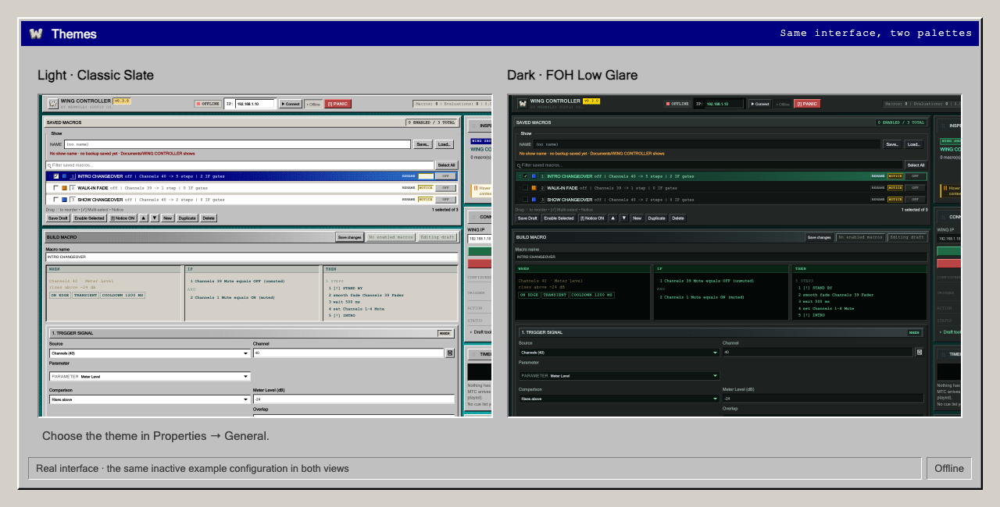](assets/product/themes.png)

<details>
<summary>HUD settings</summary>

[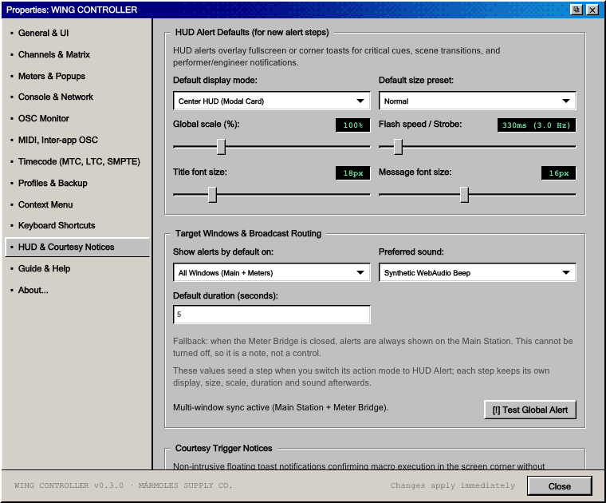](assets/product/hud-preferences-light.png)

HUD defaults seed new steps. Existing steps keep their own settings.

</details>

## Inter-app MIDI, OSC and timecode

Use incoming MIDI notes/controller messages or OSC to trigger macros between
applications, and include outgoing MIDI/OSC messages in action sequences.
[Inter-app configuration guide](docs/guide/12-midi-and-other-applications.md).

LTC (audio timecode), MTC (MIDI timecode) and cue tools are included in the beta:
inspect LTC WAV files, follow timecode inputs and associate cue positions with
macros. [Timecode guide](docs/guide/13-timecode.md). Hardware and third-party
workflows need community testing; see the [testing priorities](docs/COMMUNITY_TESTING.md#what-needs-testing).

## Help improve it

The source is here so people can study it, fix things and contribute. You do not
need to write code to help: report a bug, suggest a change, share a test result or
describe what worked and what did not.

**[Report a bug](https://github.com/marmoles-supply/wing-controller/issues/new?template=01-bug-report.yml)** · **[Suggest an improvement](https://github.com/marmoles-supply/wing-controller/issues/new?template=02-improvement.yml)** · **[Report a test](https://github.com/marmoles-supply/wing-controller/issues/new?template=03-test-report.yml)** · **[Share an experience](https://github.com/marmoles-supply/wing-controller/issues/new?template=04-experience.yml)**

[Community testing and how reports are handled](docs/COMMUNITY_TESTING.md). English
and Spanish reports are welcome. A GitHub account is needed to submit a report.

- **[Roadmap and to-do](docs/ROADMAP.md):** storage and recovery, physical LTC/MTC
  tests, hardware coverage, accessibility and maintenance.
- **[Report a bug or suggest a change](https://github.com/marmoles-supply/wing-controller/issues/new/choose):** include the version, steps and expected result; remove private show/console details.
- **[Contributing](CONTRIBUTING.md):** how to choose a task, verify a change and submit a pull request.
- **[Audit](docs/AUDIT_2026-11-09.md) · [Architecture](docs/ARCHITECTURE.md) · [Validation](docs/VALIDATION.md):** evidence, structure and checks.
- **[Security reporting](SECURITY.md):** report vulnerabilities privately.

## Compatibility

| Item | Current status |
| --- | --- |
| Mac | Apple Silicon / arm64 (M-series) |
| Checked environment | macOS 26.6.2 on arm64; a wider runtime range remains unverified |
| Intel / Windows / Linux | No supported desktop installer |
| WING consoles | WING-family protocols; model, firmware and feature availability vary |
| Mobile | Original Expo source retained; mobile work is parked |
| Release | [v0.3.0 community beta](https://github.com/marmoles-supply/wing-controller/releases/tag/v0.3.0) |

Read [known limitations](docs/KNOWN_LIMITATIONS.md) before relying on a feature.
The [package validation](docs/RELEASE_VALIDATION_0.3.0.md) records checks of the
installer separately from hardware/show acceptance.

## Licence

© 2026 **MÁRMOLES SUPPLY CO.** and contributors.

Free to use, study, modify and share under the
[WING CONTROLLER Source-Available Licence 1.0](LICENSE). **Professional use,
including paid shows, is allowed. Selling copies or derivatives is prohibited.**
Redistributions must include corresponding source under the same licence.

Because of the sale restriction, these are **source-available terms, rather than
an OSI open-source licence or GPL**. They do not become permissive later.
[Third-party components](THIRD_PARTY.md) keep their own licences. Trademarks
identify compatibility and grant no affiliation or endorsement.

## Development

<details>
<summary>Set up the source, run checks and find your way around the repository</summary>

Use an Apple Silicon Mac with Xcode Command Line Tools, Node.js **20.19 or later**
with npm, Rust/Cargo and Poppler (`pdftotext`). Chrome is needed for the complete
verification gate. Initial checks use Rust 1.98.1 and Node 26.8.2; this does not
establish that every earlier combination works.

```sh
git clone https://github.com/marmoles-supply/wing-controller.git
cd wing-controller
npm ci
node scripts/setup-protocol-reference.mjs
./scripts/verify-all.sh --quick
cargo run --locked -p wing-controller-desktop
```

Protocol setup downloads and verifies Maillot's pinned manual locally, then
extracts an ignored reference file. The complete manual is not redistributed.
See [reference acquisition/checksums](docs/PROTOCOL_REFERENCE.md).

`cargo run` compiles and launches a development app, not a release installer.
Node generates the UI vault during Cargo compilation. No maintainer signing key,
activation key, customer data or generated Android directory is needed to verify
this source checkout.

## Verification

See the [dated verification record](docs/VALIDATION.md) for measured results,
environment, dependency-cache use and what was not established.
The [0.3.0 package validation](docs/RELEASE_VALIDATION_0.3.0.md) records installer,
signature, architecture and checksum checks separately.

```sh
./scripts/verify-all.sh --quick   # Everyday checks; omits named browser suites
./scripts/verify-all.sh           # Complete source gate, including browser suites
```

Quick mode also runs the design screenshot check when Chrome is available.
Run only one gate/browser suite at a time. Scripts manage their Chrome instances;
do not drive the shared test browser concurrently. Pixel baselines depend on the
rendering environment: review differences rather than accepting them blindly.

Ordinary checks are console-free. Hardware tests need explicit `LIVE_WING_*`
opt-ins; inspect them before enabling anything against a console. A source gate
does not certify a live show, packaged app or installed system. Historical
provenance is retained; 15 archival notes lack surviving build evidence and are
explicitly labelled unverified.

## Source layout

| Path | Purpose |
| --- | --- |
| `desktop/src-tauri/` | Tauri app and native integrations |
| `desktop/ui/` | Workstation, meters, timecode, cue editor and guide |
| `crates/` | Protocol, runtime, transport and probe crates |
| `design/` | Tokens, components, reviewed renders and conformance tools |
| `scripts/` | Verification, reference setup, generation and release tools |
| `docs/guide/` | Operator guide sources |
| `src/`, `native/`, `plugins/` | Parked mobile source/integrations |

This repository starts a new public history. Private backups, operator exports,
machine diagnostics, credentials and downloaded manuals are excluded.
`SOURCE_MANIFEST.json` records the source revision and exported hashes.


</details>
