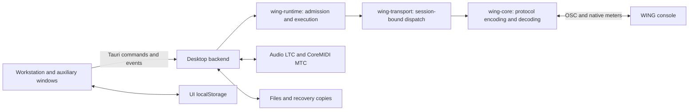

# Architecture and protocol guide for contributors

The active product is a local Tauri/Rust desktop app for Apple Silicon Macs.
The HTML/CSS/JavaScript UI is embedded locally; Node/Expo also serves retained
mobile/development work, but is not a Node runtime inside the shipped desktop app.

| Area | Start reading |
| --- | --- |
| Desktop commands, state and integration | `desktop/src-tauri/src/main.rs` |
| Workstation and station restore UI | `desktop/ui/index.html` |
| Native input and LTC codec | `desktop/src-tauri/src/ltc_device.rs`, `ltc.rs` |
| Timecode ownership/cues and MIDI | `timecode.rs`, `inter_app_midi.rs` in the desktop source |
| Runtime policies and transport | `crates/wing-runtime/`, `crates/wing-transport/` |
| WING native/OSC data structures | `crates/wing-core/`, retained `src/osc/` mobile source |
| Visual system and recorded renders | `design/` |
| Gates, fixtures and packaging | `scripts/`, `desktop/build-dist.sh` |
| Operator documentation | `docs/guide/` |

The central backend/UI files are large. Follow callers into the live path and
read its tests; a dead helper, old release note or comment is not runtime proof.
Extract one responsibility at a time rather than creating competing state paths.

## Protocol authority and change contract

Use Patrick-Gilles Maillot's WING Remote Protocols as primary authority. Acquire
the [pinned local reference](PROTOCOL_REFERENCE.md) before running path/model
audits. Do not commit the manual or its full extraction.

For protocol changes, cite the exact path/token/table in comments or the change
record, preserve Channel 3 request/decode ordering, document units/ranges and
update both macro resolution and the UI when adding targets. Respect `0xA7` and
`0xA8` group structure, renewal and value formats. Most meter values use
`1/256 dB`; apply explicit documented exceptions such as FX scaling.

PDF footnotes can attach digits to names: `/gate/thr23` is not an actual leaf.
Confirm the real leaf with the strict audit and, where needed, a controlled
read-only request. Gate/compressor/EQ leaves depend on the selected model;
read `/gate/mdl`, `/dyn/mdl` or `/eq/mdl` before claiming availability. Missing
parameters may silently ignore writes. Keep sent/confirmed/unconfirmed distinct.

OSC control uses UDP 2223; discovery uses UDP 2222; native meter subscriptions
use TCP 2222 and UDP reports. A network address in a fixture is not a user's
console. Public logs/issues must use synthetic names and addresses.

## Verification boundaries

Run one source gate/browser suite at a time. The full gate includes browser
contracts; quick mode is a development loop, not release acceptance. Ordinary
checks must not write to a desk. Hardware tools require explicit `LIVE_WING_*`
opt-ins after reading the script and arranging an isolated test rig.

Physical LTC/MTC, native permissions, cross-store crash recovery and four-hour
endurance need independent evidence beyond fixture checks. The
[roadmap](ROADMAP.md) defines those tasks and the [audit](AUDIT_2026-11-09.md)
states what has and has not been established.
